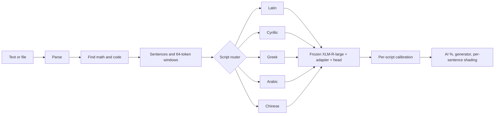

# SFA-CA: multilingual AI-text detection and attribution

[](https://www.python.org/)
[](https://pytorch.org/)
[](https://huggingface.co/docs/peft)
[](https://fastapi.tiangolo.com/)

Given a pasted text or an uploaded `.txt`, `.md`, `.docx` or `.pdf`, SFA-CA reports

1. how likely it is AI-written (percent AI versus human),
2. **which sentences** look AI-written, with math and code excluded from scoring,
3. **which of 7 generators** is the closest match (GPT-3.5, Llama-2, Mistral-7B, Vicuna, OPT-IML, Eagle-7B, Aya-101).

It covers 18 languages in five script families: Latin, Cyrillic, Greek, Arabic and Chinese. The output is a statistical
likelihood, **not proof of authorship**.

**Live page:** https://sangeeth0301.github.io/multilingual-aa-sfaca/ (works while the model laptop and tunnel are running,
see `04_pipeline_backend_frontend/REPORT.md`).

## The idea

A single large multilingual network (XLM-RoBERTa-large) stays **frozen**. For each script family a small **LoRA adapter**
and a classifier head are trained on top, so five tiny add-ons replace one model per language. A supervised contrastive
loss pulls texts from the same generator together. At inference each passage is routed to the adapter for its own script.



## Results (measured; single seed; details in each member's report)

| Family | Test macro-F1 (8 classes) | Human-vs-AI AUROC | Full-pipeline human-vs-AI accuracy |
|:-|:-:|:-:|:-:|
| Latin | 0.796 | 0.996 | 0.98 |
| Cyrillic | 0.731 | 0.984 | 0.82 |
| Greek | 0.814 | 0.986 | 0.90 |
| Arabic | 0.863 | 0.989 | 0.98 |
| Chinese | 0.597 | 0.990 | 0.83 (only 4 human documents) |

Sentence-level highlighting on mixed English documents: precision 0.83, recall 1.00, F1 0.91. Sources:
`results/runs/*/metrics.json` and `results/pipeline_eval.md`. These are single-seed, small-sample numbers; see the limits
below. The earlier results table in this README was unverified and has been removed.

## Repository layout: four members, four folders

```
README.md  TEAM_PLAN.md  configs/  requirements*.txt  sfaca_paths.py  conftest.py   shared files
data/  results/                                                                      shared inputs and outputs

01_data_engineering/           clean, leak-free, reproducible data          (REPORT.md inside)
02_model_training/             model, contrastive loss, training            (REPORT.md inside)
03_inference_evaluation/       inference engine, calibration, evaluation    (REPORT.md inside)
04_pipeline_backend_frontend/  document pipeline, API, web page, deployment (REPORT.md inside)
```

Read `TEAM_PLAN.md` for who owns what, the hand-off contracts and the schedule. Each `REPORT.md` explains the objective
and logic of every file in that folder.

## Quick start

```bash
pip install -r requirements.txt
SFACA_STUB=1 python 04_pipeline_backend_frontend/backend/api.py             # demo with placeholder scores
```
Open http://localhost:7860. For the real model you need the trained adapters:

```bash
# 1. data (private Kaggle dataset sandeep01321/sfaca-data -> data/raw/ and data/processed/)
python 01_data_engineering/scripts/check_leakage.py                          # must exit 0
# 2. train (about 2 hours on a 6 GB GPU) and collect the best runs
bash 02_model_training/scripts/train_all_local.sh
python 03_inference_evaluation/scripts/export_adapters.py
python 03_inference_evaluation/scripts/calibrate.py                          # writes configs/calibration.json
# 3. serve
ADAPTER_DIR=results/adapters python 04_pipeline_backend_frontend/backend/api.py
# 4. share from a laptop: double-click 04_pipeline_backend_frontend/ops/Start SFA-CA Public.bat
```

Run all 47 tests from the repository root:

```bash
python -m pytest -q
```

## Limits (please read)

- It is a likelihood. Short, edited or paraphrased text is unreliable, and it should never be the only evidence against a person.
- The 7 generators are from 2023. Text from newer models (GPT-4o, Claude, Gemini) is outside the training data and is mapped to the closest known one.
- Trained and evaluated on news text, one seed, small evaluation samples. Cyrillic and Chinese are the weakest families.
- Highlighting accuracy was measured in English only. Math detection is pattern-based and misses plain-text equations.
- The public link depends on a laptop and a free tunnel. A permanent host needs a paid Hugging Face Space or a small server.

## Acknowledgements

Built on the MULTITuDE benchmark (La Cava et al., ACL 2026) and LoRA (Hu et al., ICLR 2022).
